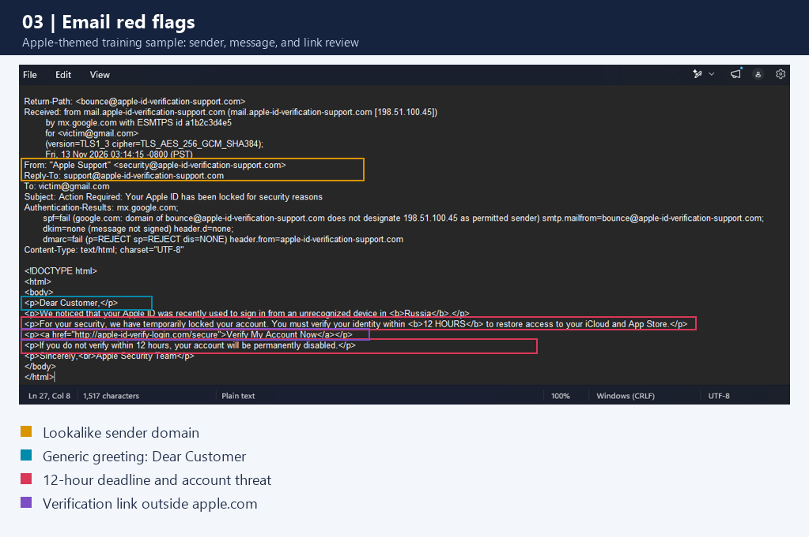

# Phishing Email Investigation & Triage

**Email header review, URL investigation, and evidence-based SOC reporting.**

I investigated an Apple-themed phishing training sample to decide whether the message should be treated as phishing. The review combines header findings, URL reputation, and social engineering indicators.

**Lab verdict: True Positive — phishing simulation.**

## Real-world scenario

An employee receives an email claiming their Apple ID is locked. It demands identity verification within **12 hours** and threatens permanent account loss. A SOC analyst must check the sender and link before deciding how to handle the message.

This project recreates that situation with a constructed `.eml` sample. It documents a training investigation, rather than a confirmed incident affecting a real user.

## Tools and workflow

**Tools:** MXToolbox, VirusTotal, and Notepad. Related training: TryHackMe, *Phishing Analysis Fundamentals*.

1. Reviewed the sender, Return-Path, and authentication information.
2. Extracted the verification URL as text for investigation.
3. Reviewed the supplied VirusTotal result alongside the email content.
4. Documented the verdict, supporting evidence, and recommended response.

## Key findings

| Area | Finding |
| --- | --- |
| Sender | Apple branding is paired with the lookalike domain `apple-id-verification-support[.]com`. |
| Header review | MXToolbox shows no SPF or DMARC record and no DKIM signature header. The constructed sample separately contains `spf=fail`, `dkim=none`, and `dmarc=fail`. |
| URL reputation | The captured VirusTotal report shows **1/93 detections**, with **ESET: Phishing**. |
| Email content | Generic greeting, a 12-hour deadline, an account-loss threat, and a verification link outside `apple.com`. |
| Training | The supplied TryHackMe screenshot shows **100% room completion**. |

The phishing verdict reflects the combined evidence and the sample's intended deception. A single VirusTotal detection or missing authentication record alone is not enough to classify every email as phishing.

## MITRE ATT&CK mapping

| Tactic | Technique | Evidence in the sample |
| --- | --- | --- |
| Initial Access | [T1566.002 — Spearphishing Link](https://attack.mitre.org/techniques/T1566/002/) | The verification link directs the recipient to a lookalike website. |
| Stealth | [T1684.001 — Impersonation](https://attack.mitre.org/techniques/T1684/001/) | The sender claims to be Apple Support and signs as the Apple Security Team. |

These mappings describe the phishing lure in the training sample. A recipient click, credential capture, or successful compromise was not demonstrated. See the [incident report](docs/incident-report.md#mitre-attck-mapping) for supporting evidence.

## Annotated evidence

| Screenshot | Highlight |
| --- | --- |
| [01-header-analysis.png](screenshots/01-header-analysis.png) | Missing authentication records and signature. |
| [02-virustotal-url.png](screenshots/02-virustotal-url.png) | The 1/93 score, ESET result, and matching URL. |
| [03-email-red-flags.png](screenshots/03-email-red-flags.png) | Lookalike sender, urgency, and verification link. |
| [04-tryhackme-proof.png](screenshots/04-tryhackme-proof.png) | Room name and completion status. |

Annotations add boxes and short captions only. Unchanged screenshots are preserved in [screenshots/originals/](screenshots/originals/).

## Project files

- [samples/phishing_sample.eml](samples/phishing_sample.eml): reconstructed training sample; inspect as text because it contains an untrusted link.
- [docs/incident-report.md](docs/incident-report.md): findings, defanged indicators, and response recommendations.
- [screenshots/](screenshots/): annotated evidence and originals.
